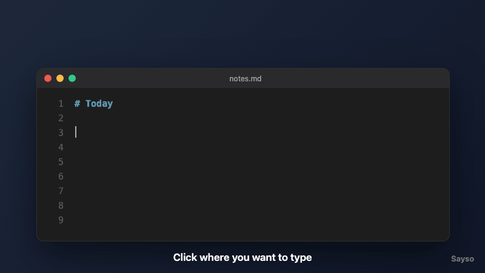

# Sayso

A macOS-only voice-to-text app. Press a global shortcut, speak, and your words are typed into whatever app you were using — transcribed locally, no cloud, no account.



<sub>Illustration of the flow.</sub>

## Tour

1. **Click into any text field** — Terminal, Notes, Slack, a browser address bar.
2. **Press ⌘⇧Space and speak.** A small floating overlay appears (drag it anywhere); the bars move with your voice.
3. **Press ⌘⇧Space again** (or click ■). Your speech is transcribed on this Mac — no audio leaves your machine.
4. **It's pasted where your cursor was.** It's also left on your clipboard, so ⌘V works if the paste didn't land. Every transcript is also saved to your history (see **Dashboard** below).

**Bullet points:** start with a cue such as "points", "bullet points" or "list", then pause between items (or say "next point"):

> *"Points … buy milk … call the bank … renew passport"* → `- Buy milk` / `- Call the bank` / `- Renew passport`

The cue has to stand on its own (followed by a pause or punctuation), so "list the files in this folder" stays plain text. Without a cue, nothing changes.

**First run:** a welcome window walks through these steps and shows whether **Microphone** and **Accessibility** are granted, with a Grant button for each. Reopen it any time from the menu-bar icon → **How to use Sayso**.

**Dashboard:** menu-bar icon → **Open Dashboard**.
- **Home:** dictations, words, words this week, and minutes saved (compared with typing at 40 wpm), plus your latest dictations.
- **History:** every dictation, newest first and grouped by day, with search, Copy, Delete and Clear all.
- **Settings:** turn history saving off. Your shortcut and model are shown there too.

History lives only on this Mac, in `~/Library/Application Support/com.sayso.app/history.db` (SQLite). Audio is never stored.

The Whisper model (`ggml-base.en.bin`, ~140MB) downloads automatically into the app's data directory the first time you record; after that everything works offline.

## Troubleshooting

| Symptom | Cause | Fix |
|---|---|---|
| Overlay says "Microphone access is off", or bars don't move | No Microphone permission | System Settings → Privacy & Security → Microphone → enable Sayso. In dev, enable the **terminal app** you ran `npm run tauri dev` from, then restart it. |
| Transcript isn't pasted | No Accessibility permission, or macOS refused to switch back to the target app | Press ⌘V — the transcript is on your clipboard. Check Privacy & Security → Accessibility. In dev, look for a `paste failed:` line in the terminal. |
| Nothing happens for silence | Expected | Silent recordings (Whisper's `[BLANK_AUDIO]` etc.) are dropped; focus returns to your app. |

## How it works

```
⌘⇧Space ─▶ remember frontmost app ─▶ show overlay ─▶ mic capture (Web Audio)
                                                          │
⌘⇧Space / ■ ◀─────────────────────────────────────────────┘
    │
    ▼
samples ─▶ Rust: resample to 16 kHz ─▶ Whisper (local) ─▶ drop non-speech markers ─▶ bullets if cued
    │
    ├─▶ save to history.db (app data dir) ─▶ dashboard refreshes
    └─▶ clipboard ─▶ re-activate remembered app ─▶ wait until frontmost ─▶ ⌘V
```

- The first shortcut press records which app was in front (`NSWorkspace.frontmostApplication`) before the overlay takes focus.
- The overlay captures raw audio in the webview; on stop, the samples go to the `transcribe_recording` command.
- Transcription runs `whisper-rs` (whisper.cpp) against a model held in memory.
- Pasting puts the text on the clipboard, re-activates the remembered app, and posts ⌘V only once that app is confirmed frontmost — so it never pastes into the wrong window. If there's nothing to paste, focus is still handed back.

| File | Responsibility |
|---|---|
| `app/src/App.tsx` | Overlay: amplitude bars, mic capture, stop handling |
| `app/src/Welcome.tsx` | Welcome tour and live permission status |
| `app/src-tauri/src/lib.rs` | Global shortcut, tray menu, window wiring, `stop_recording` |
| `app/src-tauri/src/audio.rs` | Resampling to 16 kHz |
| `app/src-tauri/src/transcribe.rs` | Whisper transcription, non-speech filtering |
| `app/src-tauri/src/points.rs` | Pause detection and bullet-point formatting for spoken lists |
| `app/src-tauri/src/model.rs` | Model download and location |
| `app/src-tauri/src/paste.rs` | Remembered target app, clipboard, activation, ⌘V |
| `app/src-tauri/src/welcome.rs` | First-launch detection, welcome window |
| `app/src-tauri/src/history.rs` | SQLite history, stats, settings, dashboard commands |

## Status

- ✅ Global shortcut, draggable overlay, live amplitude bars
- ✅ Local transcription (offline Whisper) saved to a local history
- ✅ Pastes into the app that was focused when you started recording (clipboard + ⌘V; needs Accessibility)
- ⚠️ On recent macOS, re-activating some apps (seen with Chrome) can be refused — the transcript stays on the clipboard
- ✅ Welcome tour with live permission status
- ✅ Dashboard: stats, searchable history, save-history setting
- ⬜ More settings (hotkey, model, language), auto-launch

## Running it

```bash
cd app
npm install
npm run tauri dev
```

Requires [Rust](https://www.rust-lang.org/tools/install), [CMake](https://cmake.org/) (`brew install cmake` — needed to build whisper.cpp), and Xcode Command Line Tools.

Tests: `cd app/src-tauri && cargo test` (Rust) and `cd app && npm run build` (type-check).

To see the welcome window again as a first-time user, delete `~/Library/Application Support/com.sayso.app/welcome-seen` and relaunch.

## Project layout

- `app/src/` — React frontend (overlay, welcome tour, dashboard, mic capture)
- `app/src-tauri/src/` — Rust backend (shortcut, tray, transcription, paste, welcome, history)
- `output/transcripts/` — transcripts from older builds (gitignored; no longer written)
- `docs/superpowers/` — design specs and implementation plans (local only; `*.md` is gitignored apart from this README)
- `plan.md` / `claudeplan.md` — the original project plan
